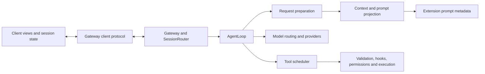

# Runtime boundaries

PilotDeck shares one backend across Web, desktop, CLI and messaging adapters.
Keep execution policy and resource ownership in that backend; clients project
events into views. A module should depend on the contract it consumes, rather
than reaching into another module's process or UI state.

## Ownership and communication

| Boundary | Owns | Contract |
| --- | --- | --- |
| [WebSocket transport](../../ui/src/contexts/WebSocketContext.tsx) | Connection/reconnect state and subscription delivery | Deliver every received frame synchronously to subscribers; React state is a view projection, not an event queue. |
| [Session store](../../ui/src/stores/useSessionStore.ts) | Client history, optimistic state, ordered timeline and render notifications | Batch renders without dropping events; cancel scheduled notifications when the view unmounts. |
| [Gateway](../../src/gateway/README.md) | Sessions, accepted turns, runtime selection and reload | Project invalidation is scoped; a session, active turn or background task retains its runtime lease. |
| [Agent execution](../../src/agent/README.md) | Routing, continuation, recovery, lifecycle events and tool execution | Request preparation receives narrow dependencies and returns a canonical request; it does not execute tools or choose a route. |
| [Context](../../src/context/README.md) | Projection, instructions, retrieval, token budgets and compaction | Preview preparation must not consume live cache resets or advance session state. |
| [Extensions](../../src/extension/README.md) | Discovery, preferences, contribution precedence and runtime resources | Prompt consumers receive typed metadata; hook and server configuration are composed separately. |
| [Tools](../../src/tool/README.md) | Registry ownership, scheduling, input validation, permission and audit | Revalidate the effective input after hooks/permission changes and before execution. |
| [Models](../../src/model/README.md) | Canonical messages and provider wire formats | Shared user-request classification distinguishes accepted tasks from injected context and tool results. |

`createLocalGateway` is the composition root. Runtime configuration, plugin
resources, providers and adapters meet there; feature code should consume the
resulting interfaces. Reload retires the selected runtime and reconstructs it
for new owners. Existing owners finish on their snapshot. Session eviction owns
session MCP cleanup; Gateway shutdown owns forced disposal.

## Prompt and extension contracts

`prepareModelRequest` supplies the model-visible tool inventory to context.
Prompt guidance must describe those capabilities, including restricted ask mode
and sessions without interactive prompts. A custom prompt replaces default
extension sections while preserving verified environment/Python context.

`PluginPromptContributions` contains commands, resolved skill paths and MCP
instructions. A fresh projection reads skill preferences once, retains scope
precedence and does not aggregate unrelated hooks or server configuration.
Legacy list resolvers remain supported. Do not retain the projection across
preference changes or plugin refreshes.

Render command and skill metadata deterministically. Keep stable instructions
in the system prefix and retrieved memory in synthetic reference messages after
history. Retrieval, model routing and subagent detection use the actual user
request; injected reference text must not become a task or a model override.
Prepared context does not rewrite the persisted transcript. Cache fingerprints
describe the prepared request; provider-reported usage measures actual reuse.

## Tool execution contracts

Registry updates validate all names/aliases before mutation. Redundant aliases
remain compatible; a replacement cannot take another tool's name or alias.
Schema, plan/ask restrictions, interaction requirements and todo gates apply to
the effective input, including permission-hook replacements.

The scheduler overlaps consecutive concurrency-safe calls with a per-batch
limit of four by default. Exclusive and unknown calls form ordering barriers.
Results retain submitted order. An input rewrite that changes a parallel call
to exclusive is rejected before its body starts and can be retried alone.
Ordinary tool errors are paired results; unexpected failures stop new dispatch
and drain started calls. Running bodies must cooperate with cancellation.

## Client state and compatibility

The active shell uses the `*-v2` presentation components and shared `chat`
modules. These are live dependencies, not separate applications. Shared chat
utilities and rendering components must not import the versioned presentation
layer. Use the reachability audit and actual entry points before removing code.

`SessionHistoryCache` retains at most eight inactive, confirmed history-only
snapshots. Active and loading sessions are retained. Live, optimistic, pending,
incomplete-tool and timeline-gap state stays pinned until its durability can be
proven; this is not a global memory cap. Revisiting an evicted history refetches
the backend transcript. Search text is indexed while search is open, rather than
on every streaming update while the search UI is closed.

Retain historical transcript migrations, compatibility adapters, runtime skills,
distribution assets and genuine regression fixtures. Version labels alone do
not establish that a file is obsolete.

## Validation

See [testing](../testing.md) for deterministic contracts and browser acceptance.
For a boundary change, compare baseline and updated behavior on the same inputs:
normal paths preserve their observable outputs, while a defect fixture must
demonstrate the intended difference. Real-model evaluations use synthetic tools
and isolated profiles; report provider availability and cache usage separately
from deterministic correctness.
